<div align="center">

# 📊 NEXUS BI
### End-to-End Data Analytics & Business Intelligence Project

*Turning 100k raw e-commerce orders into decisions: from messy CSVs to SQL, statistics, machine learning and an interactive Power BI report.*


**[🎯 Business problem](#-the-business-problem)** ·
**[📈 Key results](#-key-results)** ·
**[💡 Insights](#-top-business-insights)** ·
**[🧠 Core competencies](#-core-competencies)** ·
**[🏗️ Architecture](#%EF%B8%8F-architecture)** ·
**[📊 Dashboards](#-dashboards)** ·
**[🤖 Machine learning](#-machine-learning)** ·
**[🚀 Run it](#-run-it-yourself)**

</div>

---

## 🎯 The business problem

**Olist** is a Brazilian e-commerce marketplace. Its public dataset holds about 100k orders (Sep 2016 to Aug 2018, values in **BRL**) spread across 9 linked CSV files covering orders, items, payments, reviews, customers, sellers, products and geolocation.

Leadership wants answers to five questions:

| # | Business question | Where it is answered |
|:-:|---|---|
| 1 | How much revenue do we make, and is it still growing? | SQL Q01–Q05 · Executive page · revenue forecast |
| 2 | Who are our customers, and do they come back? | RFM, cohorts, segmentation, churn model |
| 3 | Does delivery performance affect customer satisfaction? | Hypothesis tests H1–H4 · Operations page |
| 4 | Which sellers, categories and regions drive or hurt the business? | Seller quadrant, category treemap, state map |
| 5 | Which days look abnormal, and what will demand look like next? | Anomaly detection · demand forecast |

> **Honesty rule used throughout:** every number in this README is computed from the data by the code in this repo. Simulated cost and inventory data lives only in `data/synthetic` / `syn_*` tables, is flagged `is_synthetic = true`, and is never presented as a finding.

---

## 📈 Key results

<table>
<tr>
<td align="center"><h3>R$ 15.74M</h3>Revenue</td>
<td align="center"><h3>98,207</h3>Revenue orders</td>
<td align="center"><h3>94,990</h3>Unique customers</td>
<td align="center"><h3>R$ 160.23</h3>Avg order value</td>
</tr>
<tr>
<td align="center"><h3>93.2%</h3>On-time delivery</td>
<td align="center"><h3>4.09 / 5</h3>Avg review score</td>
<td align="center"><h3>3.04%</h3>Repeat-customer rate</td>
<td align="center"><h3>20 / 20</h3>SQL ↔ Python checks pass</td>
</tr>
</table>

<details>
<summary><b>📐 How these KPIs are defined (click to expand)</b></summary>

| KPI | Definition |
|---|---|
| Revenue | Item price + freight for orders that are not `canceled` or `unavailable` |
| Revenue orders | 98,207 of 99,441 total orders meet the revenue rule above |
| On-time delivery | Delivered on or before the estimated delivery date |
| Repeat-customer rate | Share of unique customers (`customer_unique_id`) with 2+ revenue orders |
| Reconciliation | 13 KPIs and 7 cross-layer row counts recomputed in both SQL and pandas; all 20 match |

Full definitions: [KPI_DEFINITIONS.md](docs/business_requirements/KPI_DEFINITIONS.md)
</details>

---

## 💡 Top business insights

| # | Insight | Evidence | Recommended action |
|:-:|---|---|---|
| 1 | 🔁 **Retention is almost non-existent** | Repeat rate 3.04%; month-1 cohort retention 0.48% | Second-purchase programme for recent one-time buyers, A/B tested |
| 2 | 🚚 **Late deliveries destroy satisfaction** | Avg review 4.29 on time vs **1.73** when 16+ days late (69% one-star); Mann-Whitney, r = 0.638 | Region-specific delivery promises, proactive delay notifications |
| 3 | 📉 **Growth plateaued in 2018** | 2018 monthly revenue stuck between R$ 0.98M and R$ 1.16M | Pair acquisition with retention; push growth categories |
| 4 | 🏪 **Seller base is concentrated** | Top 5% of sellers = **53.3%** of GMV; 171 high-volume, low-rated sellers hold R$ 4.37M GMV | Seller quality programme for the "volume at risk" quadrant |
| 5 | 🗺️ **Regional service gap** | Nordeste: 20.0 days average delivery, 87.3% on time, vs Sudeste 10.8 days, 93.9% | Regional fulfilment and seller recruitment in the Northeast |
| 6 | 💳 **Installments unlock big baskets** | AOV R$ 101 (1 installment) → R$ 355 (11+) | Promote installment options on high-ticket categories |
| 7 | ⚡ **Black Friday is an anomaly to plan for** | 2017-11-24 flagged High severity: R$ 178k in one day; Nov-2017 late rate 12.4% | Capacity planning ahead of peak events |

<table>
<tr>
<td width="50%">

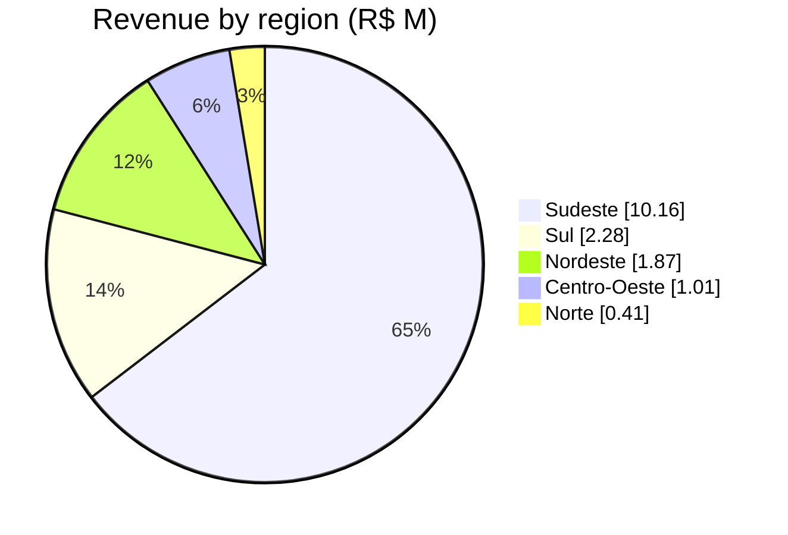

</td>
<td width="50%">

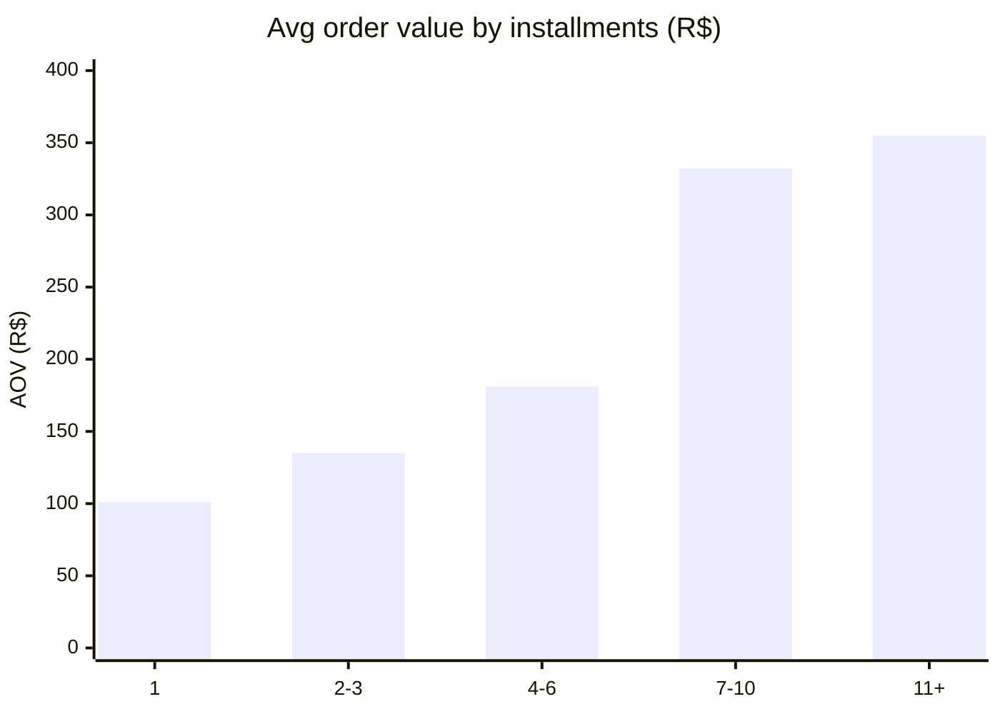

</td>
</tr>
</table>

📄 Full write-up with the business problem, metric, explanation, action and KPI for each insight: [BUSINESS_INSIGHTS_REPORT.md](docs/business_requirements/BUSINESS_INSIGHTS_REPORT.md)

---

## 🧠 Core competencies

This project was built to cover the full skill set of a data analyst, plus the engineering and data-science skills around it. Each competency links to where it is used.

### 1. Business & analytical thinking
| Competency | How it is used in this project |
|---|---|
| Requirements gathering | Business questions, stakeholders and success criteria in [BUSINESS_REQUIREMENTS.md](docs/business_requirements/BUSINESS_REQUIREMENTS.md) |
| KPI design | Revenue, AOV, on-time %, repeat rate, retention, GMV share with documented definitions ([KPI_DEFINITIONS.md](docs/business_requirements/KPI_DEFINITIONS.md)) |
| Data storytelling | Each of the 9 insights is laid out as problem → metric → explanation → action → KPI to monitor |
| Critical thinking | Correlation vs causation stated explicitly; A/B testing recommended before scaling any action |

### 2. Data collection, cleaning & quality
| Competency | How it is used in this project |
|---|---|
| Data profiling | Auto-discovery of the 9 CSVs, schema validation, column profiling ([notebook 01](notebooks/01_data_understanding.ipynb)) |
| Data quality checks | **100 automated DQ checks** (nulls, duplicates, ranges, referential integrity, date logic) with an [HTML report](reports/data_quality/data_quality_report.html) |
| Data cleaning | One transform per dataset with a cleaning log: type casting, deduplication, date fixes, outlier flags ([src/transformation](src/transformation)) |
| Handling bad data | Truncated capture after 2018-08-22 detected and excluded from modelling windows |

### 3. SQL & data modelling
| Competency | How it is used in this project |
|---|---|
| Dimensional modelling | PostgreSQL **star schema** across `raw → staging → dw` layers, with fact and dimension tables |
| Slowly changing dimensions | SCD Type 1 and Type 2 handling ([sql/dimensions](sql/dimensions)) |
| Advanced SQL | **47 documented queries** using CTEs, window functions (`LAG`, `NTILE`, `DENSE_RANK`), `PERCENTILE_CONT`, `FILTER (WHERE …)`, `GENERATE_SERIES` ([sql/analytics](sql/analytics)) |
| Analytical SQL patterns | RFM scoring, cohort retention, YoY growth, Pareto / GMV concentration, seller quadrants |
| Performance & governance | Indexes, views, materialized views, stored procedures, **row-level security** |
| Validation | SQL ↔ Python reconciliation: **20/20 checks pass** |

### 4. Python for data analysis
| Competency | How it is used in this project |
|---|---|
| pandas / NumPy | ETL pipeline, marts, feature engineering |
| Exploratory data analysis | 5 executed notebooks: univariate, bivariate, multivariate, time series, geographic and outlier analysis ([notebooks](notebooks)) |
| Visualisation | matplotlib, seaborn and Plotly: 14 EDA charts and 6 ML charts ([reports/figures](reports/figures)) |
| Reusable code | Modular `src/` package with config, logging and a single pipeline entry point |

### 5. Statistics
| Competency | How it is used in this project |
|---|---|
| Hypothesis testing | 6 formal tests: Mann-Whitney U, Kruskal-Wallis, Chi-square, Spearman, Welch t-test ([hypothesis_tests.csv](reports/eda/hypothesis_tests.csv)) |
| Effect sizes | Rank-biserial r, epsilon², Cramér's V, reported alongside every p-value |
| Distribution-aware choices | Non-parametric tests for skewed review and price data; log transform for order value |
| Honest conclusions | H5 (weekend vs weekday order value) correctly **fails to reject** H0 |

### 6. Business intelligence & dashboarding (Power BI)
| Competency | How it is used in this project |
|---|---|
| Data modelling in Power BI | 21 tables, 20 relationships, star schema in **TMDL** source format |
| DAX | **80 measures**: time intelligence, `TREATAS` for cross-fact filtering, `FILTER` over expanded tables, data-driven colour measures, targets |
| Report design | **6 pages, 82 visuals**: area, donut, gauge, treemap, ribbon, scatter, combo, 100% stacked, heat-map matrix |
| Interactivity | Slicers, drill-down (year → quarter → month), drill-through to a **Seller Detail** page, a **report-page tooltip**, page navigator, cross-filtering |
| Security | **7 RLS roles** (region-based) |
| Accessibility | Alt text on every visual and logical tab order, checked against WCAG / EN 301 549 with **0 issues** in the audit |
| Version control for BI | PBIP / PBIR project (text-based, diff-able), not a binary PBIX |

### 7. Machine learning & predictive analytics
| Competency | How it is used in this project |
|---|---|
| Customer segmentation | RFM + K-Means, k chosen by silhouette score |
| Classification | Churn prediction: Logistic Regression, Random Forest and XGBoost vs a prior baseline, time-based splits |
| Time-series forecasting | SARIMA, XGBoost, seasonal-naive and an ensemble, using a rolling-origin backtest |
| Anomaly detection | Isolation Forest, z-score and rolling threshold with consensus voting |
| Explainability | **SHAP** drivers for churn and anomalies |
| Model evaluation | ROC-AUC, PR-AUC, lift, MAE, RMSE, MAPE, WAPE, always compared with a naive baseline ([evaluation report](reports/ml/MODEL_EVALUATION_REPORT.md)) |

### 8. Data engineering & deployment
| Competency | How it is used in this project |
|---|---|
| ETL / ELT pipeline | Ingestion → validation → transformation → warehouse → SQL → ML → publish |
| Orchestration | Apache Airflow DAG, tested end to end with `airflow dags test` |
| APIs | FastAPI with Pydantic validation and Swagger docs at `/docs` |
| Web app | Streamlit: 9 pages, global filters, dark/light theme, connected to the API |
| Containers | Dockerfile and docker-compose (db, pipeline, api, app) |
| Testing | pytest unit, data-quality, SQL integration, API, ML and Power BI tests: **105 passed, 3 skipped** |
| Version control & docs | Git/GitHub, secrets kept out of the repo (`.env.example` only), 20+ documentation files |

<details>
<summary><b>🧰 Full tool stack (click to expand)</b></summary>

| Area | Tools |
|---|---|
| Languages | Python, SQL (PostgreSQL), DAX, Power Query (M) |
| Data | pandas, NumPy, PyArrow, SQLAlchemy, psycopg |
| Statistics | SciPy, statsmodels |
| Visualisation | matplotlib, seaborn, Plotly, Power BI, Streamlit |
| Machine learning | scikit-learn, XGBoost, SHAP, joblib |
| Apps & APIs | FastAPI, Uvicorn, Pydantic, Streamlit, httpx |
| Orchestration & ops | Apache Airflow, Docker, docker-compose, Makefile, PowerShell runner |
| Quality | pytest, 100 DQ checks, SQL ↔ Python reconciliation |
| Notebooks | Jupyter (nbformat / nbconvert) |

</details>

---

## 🏗️ Architecture

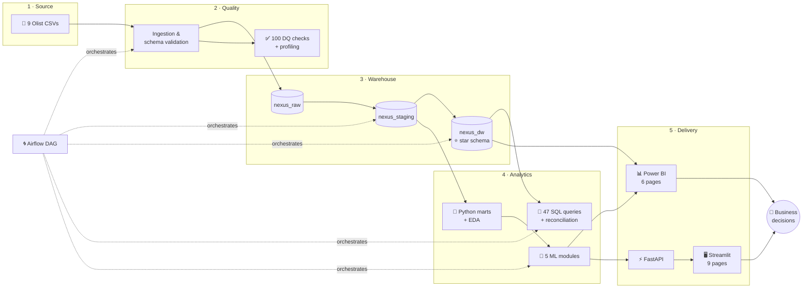

<details>
<summary><b>⭐ Star schema (click to expand)</b></summary>

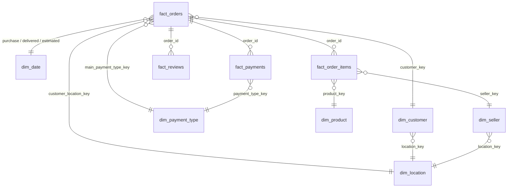

Simplified view. The full schema, columns and keys are in [DATABASE_SCHEMA.md](docs/database/DATABASE_SCHEMA.md) and the [Data Dictionary](docs/database/DATA_DICTIONARY.md).
</details>

---

## 📊 Dashboards

### Power BI report: 6 interactive pages

| Page | What you can do |
|---|---|
| 🏠 **Executive Command Center** | KPI tiles, revenue area chart with drill-down (year → quarter → month), payment-mix donut, on-time gauge vs 90% target, category treemap, state revenue, quarter × region ribbon |
| 👥 **Customer Intelligence** | Segment donut, state scatter, RFM bars, cohort-retention heat map, segment mix by region |
| 🚚 **Operations Intelligence** | Orders vs late-rate combo chart, review distribution (red → green), review gauge, late-rate traffic lights by state, seller scatter and table |
| 🔮 **Predictive Intelligence** | Revenue forecast, churn-risk donut, demand forecast by category, anomaly months |
| 🏪 **Seller Detail** *(drill-through)* | Right-click any seller to see its own KPIs |
| 🏷️ **Category Tooltip** | Hover a category to see a mini report |

> 📸 Power BI screenshots will be added in `docs/user_manual/screenshots/powerbi_*.png`. Open `powerbi/NexusBI.pbip` in Power BI Desktop (enable the PBIR and TMDL preview features) to explore it live.

### Streamlit app: 9 pages (real screenshots)

| Executive Overview | Customer Intelligence |
|:-:|:-:|
| 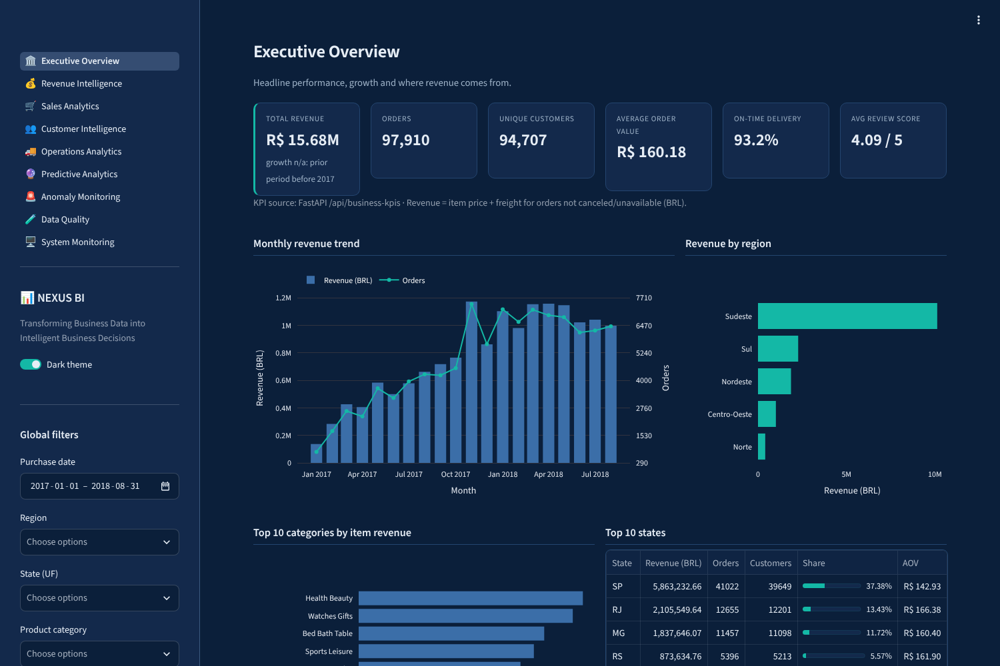 | 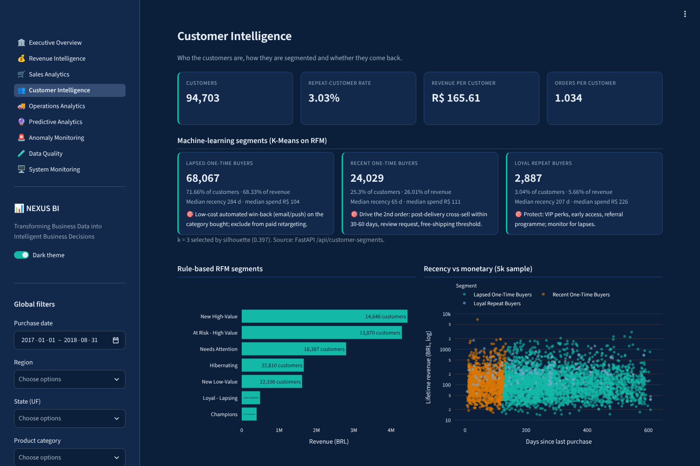 |
| **Predictive Analytics** | **Operations Analytics** |
| 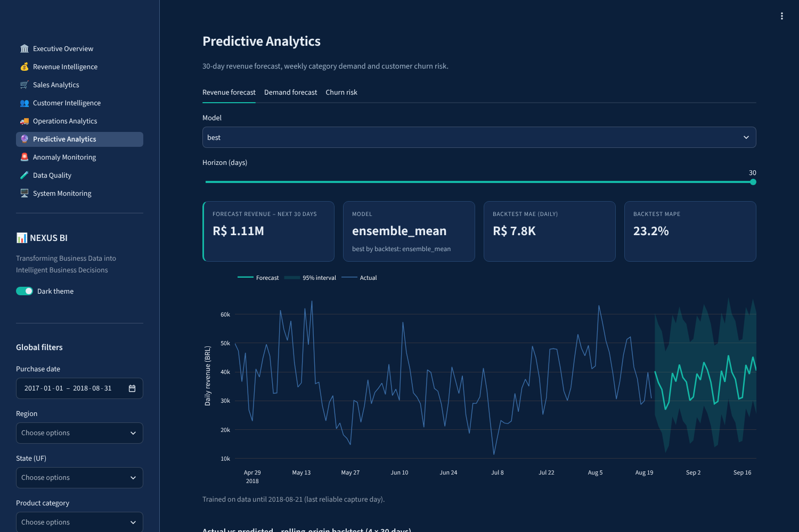 | 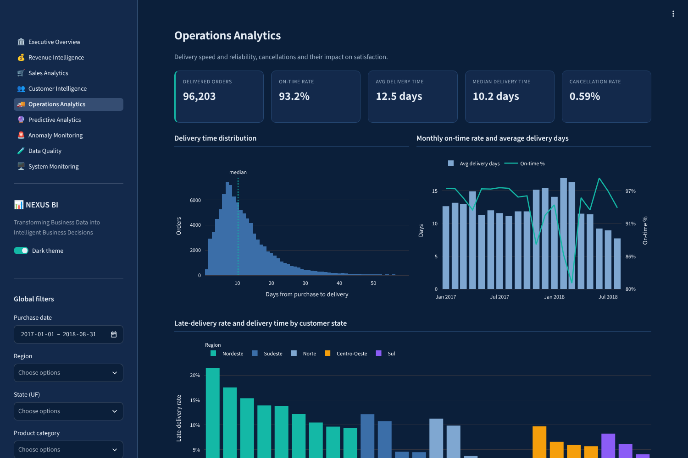 |
| **Revenue Intelligence** | **Anomaly Monitoring** |
| 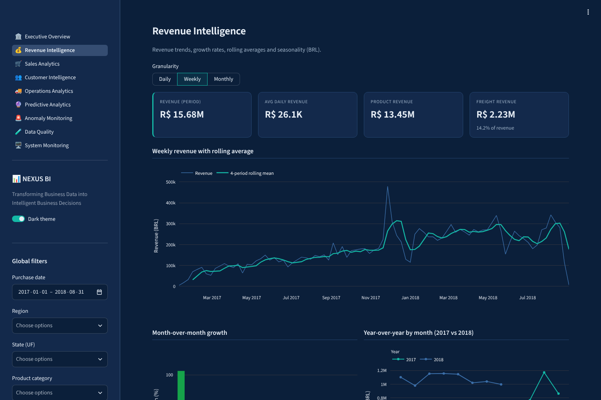 | 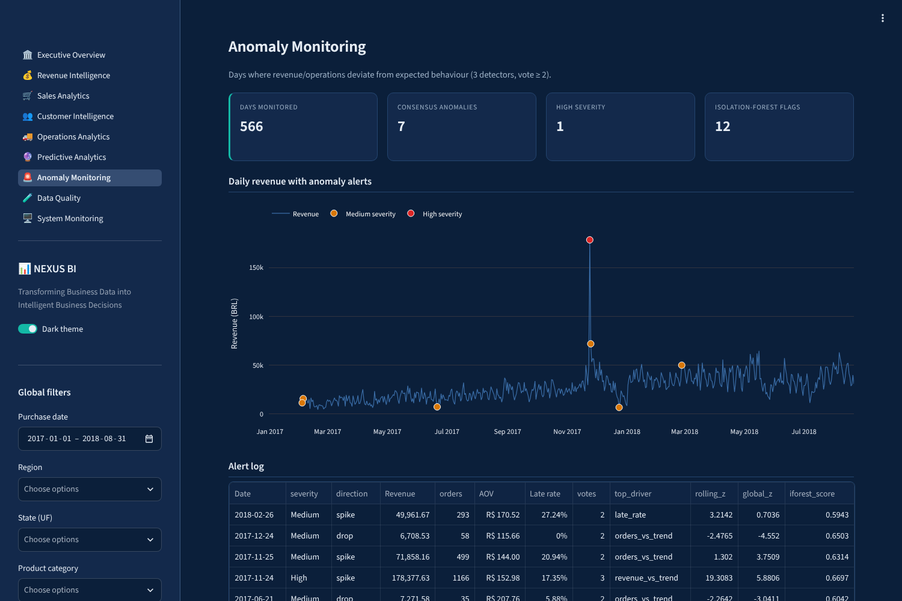 |

<details>
<summary><b>🔍 EDA highlights: charts from the notebooks (click to expand)</b></summary>

| Delivery delay vs review score | Cohort retention |
|:-:|:-:|
| 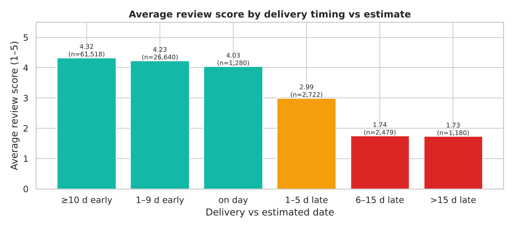 | 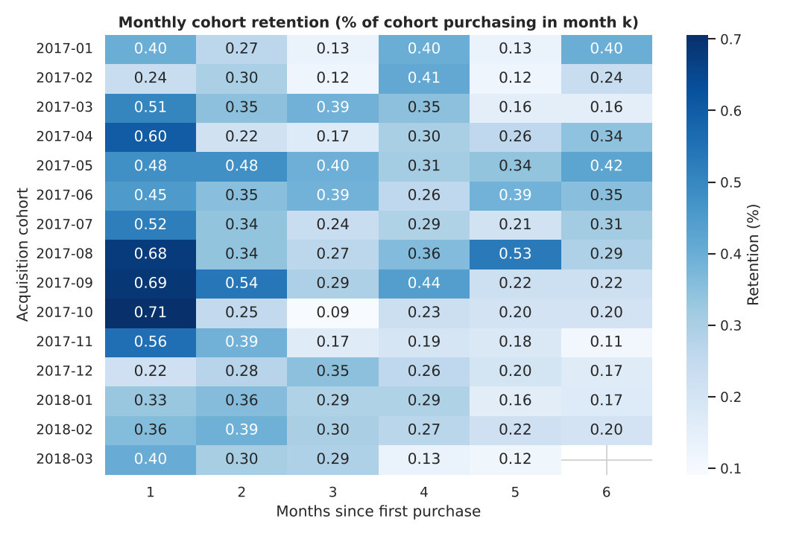 |
| **Revenue over time** | **Revenue by state** |
| 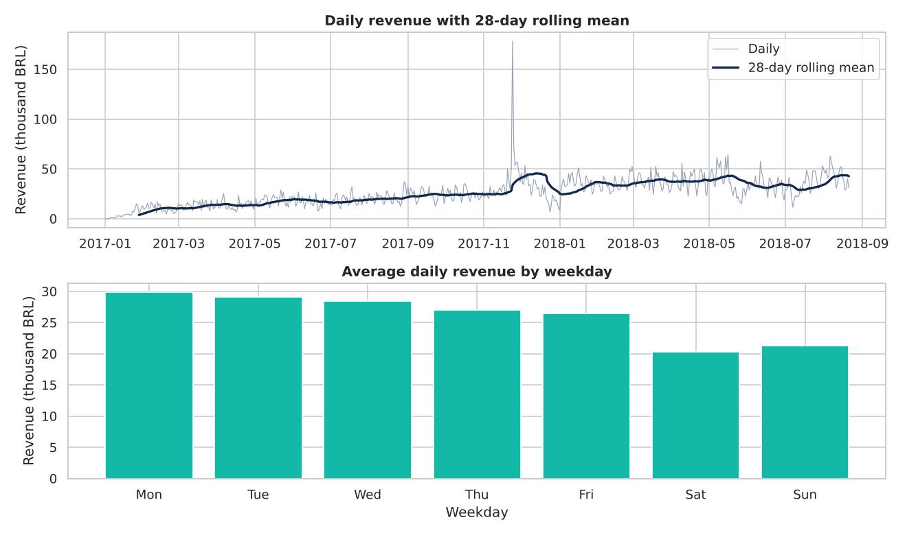 | 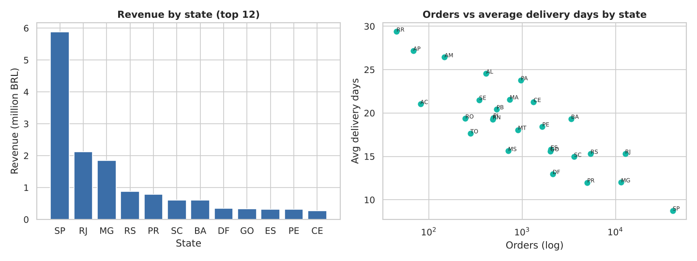 |
| **Top categories** | **Customer value concentration** |
| 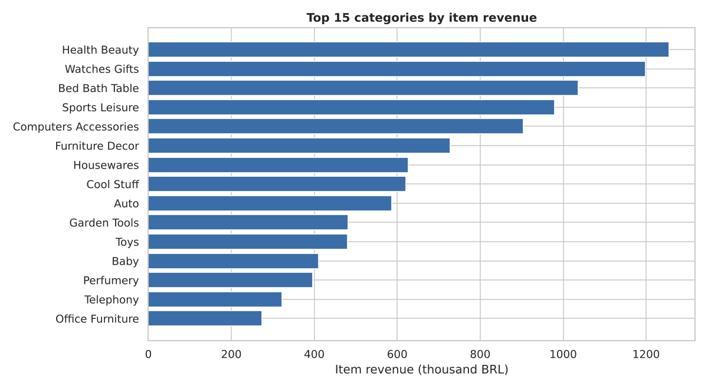 | 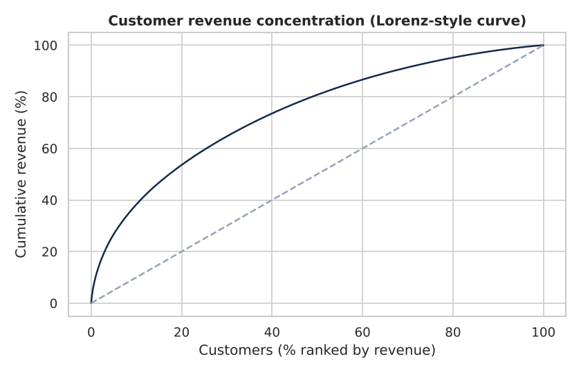 |

</details>

---

## 🧪 Statistical tests

| ID | Hypothesis | Test | Effect size | Result |
|:-:|---|---|---|:-:|
| H1 | Late orders get lower reviews | Mann-Whitney U | r = 0.638 | ✅ Reject H0 |
| H2 | Review scores differ by region | Kruskal-Wallis | ε² = 0.0025 | ✅ Reject H0 (tiny effect) |
| H3 | Late delivery is independent of region | Chi-square | Cramér's V = 0.076 | ✅ Reject H0 |
| H4 | Longer delivery → lower review | Spearman | ρ = −0.235 | ✅ Reject H0 |
| H5 | Weekend vs weekday order value | Welch t-test (log) | ratio 0.993 | ❌ Fail to reject |
| H6 | Card vs boleto order value | Mann-Whitney U | median 109.50 vs 93.82 | ✅ Reject H0 |

> With roughly 100k rows almost everything is "significant", so the effect size is what decides whether a finding matters to the business.

---

## 🤖 Machine learning

| Module | Approach | Result (measured) |
|---|---|---|
| 👥 Customer segmentation | RFM + K-Means (k = 3, silhouette 0.397) | 3 segments: Recent one-time (25.3%), Lapsed one-time (71.7%), Loyal repeat (3.0%) |
| 🔁 Churn prediction | LogReg / Random Forest / XGBoost, time-based splits | Test ROC-AUC **0.582**, **2.0×** lift in top decile, used for **ranking only** |
| 💰 Revenue forecasting | SARIMA, XGBoost, seasonal-naive, ensemble | Ensemble best: MAE R$ 7,820/day, MAPE 23.2% |
| 📦 Demand forecasting | Naive, moving average, XGBoost (top 10 categories) | Naive best: WAPE 25.7% |
| ⚠️ Anomaly detection | Isolation Forest + z-score + rolling threshold | 7 consensus anomalies, incl. **Black Friday 2017** |

<details>
<summary><b>🔬 Why the models are presented honestly (click to expand)</b></summary>

- **Churn:** about 98.8% of customers churn, so "everyone churns" already scores a high F1. The model is judged on ranking (ROC-AUC, lift), not on accuracy.
- **Forecasting:** simple baselines are hard to beat on this data. The ensemble is only about 3% better than seasonal-naive, and that gap is reported as it is.
- **Anomalies:** there are no labelled incidents, so precision and recall cannot be measured. The flags are validated against known events such as Black Friday.

| Revenue backtest | Churn SHAP drivers |
|:-:|:-:|
| 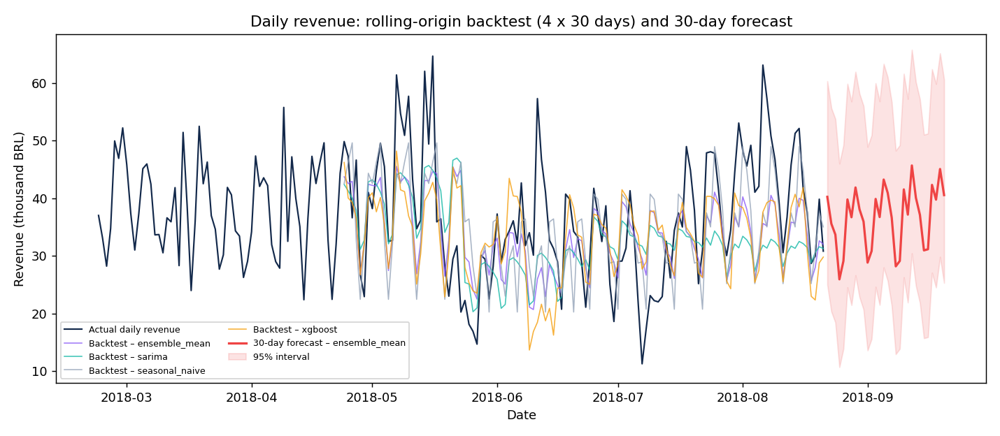 | 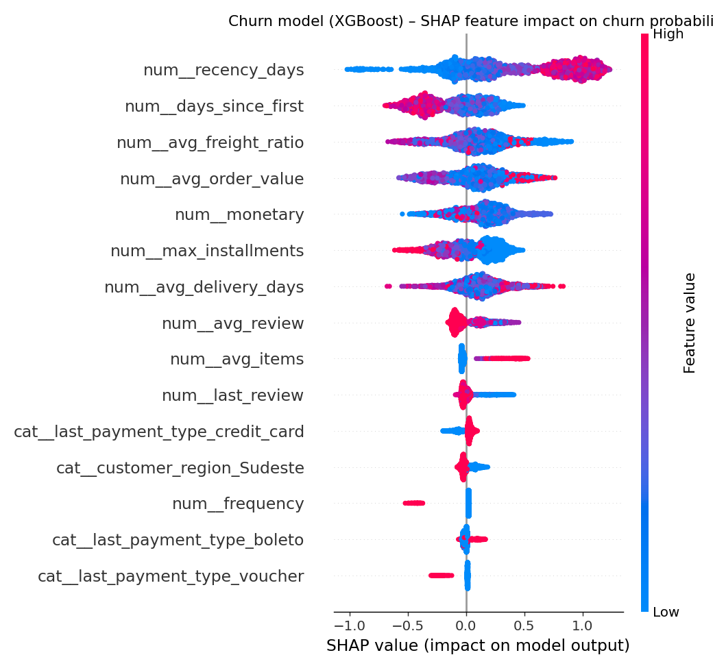 |
| **Anomaly detection** | **Segmentation: elbow & silhouette** |
| 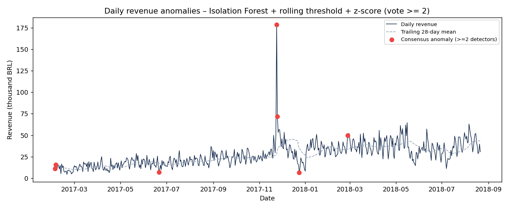 | 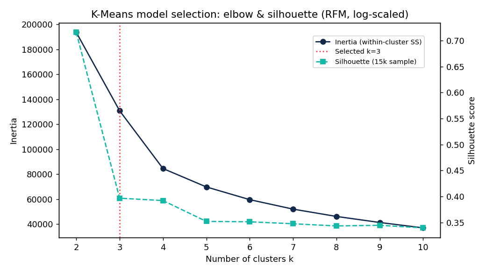 |

Full metrics: [MODEL_EVALUATION_REPORT.md](reports/ml/MODEL_EVALUATION_REPORT.md)
</details>

---

## 🚀 Run it yourself

**Prerequisites:** Python 3.10+ · PostgreSQL 14+ (local, or `docker compose up -d db`) · the 9 [Olist CSVs](https://www.kaggle.com/datasets/olistbr/brazilian-ecommerce) placed in `data\raw\`

```powershell
# 1 · Install (creates .venv, installs requirements, creates .env)
.\scripts\nexus.ps1 setup

# 2 · Create the database once (in psql as postgres), then put the password in .env
#     CREATE ROLE nexus LOGIN PASSWORD '<your password>';  CREATE DATABASE nexus_bi OWNER nexus;
.\scripts\nexus.ps1 init-db

# 3 · Run the full pipeline: ETL → warehouse → SQL → ML → publish
.\scripts\nexus.ps1 pipeline

# 4 · Start the API and the app (two terminals)
.\scripts\nexus.ps1 api     # http://localhost:8000/docs
.\scripts\nexus.ps1 app     # http://localhost:8501

# 5 · Power BI: regenerate the project for your data folder, then open powerbi\NexusBI.pbip
.\scripts\nexus.ps1 powerbi
```

<details>
<summary><b>Other ways to run (click to expand)</b></summary>

- **No PostgreSQL:** `.\scripts\nexus.ps1 pipeline-no-db` runs ingestion, validation, transformation and ML on files only. The API and Streamlit work; SQL analytics and the Power BI extracts need the database.
- **Linux / macOS:** `make install init-db pipeline`, then `make api` / `make app`
- **Docker:** `docker compose up -d db && docker compose --profile pipeline run --rm pipeline && docker compose up -d api app`
- **Tests:** `pytest`. Airflow and PySpark tests skip unless those environments are installed.

</details>

---

## 📁 Repository layout

```
NEXUS-BI/
├── data/            raw (git-ignored) · staging · processed · synthetic · sample (2k orders, committed)
├── notebooks/       01–05 executed analysis notebooks
├── src/             ingestion · validation · transformation · database · analytics · pipeline.py
├── sql/             raw · staging · dimensions · facts · views · procedures · optimization · analytics · warehouse
├── ml/              segmentation · churn · revenue & demand forecasting · anomaly detection · evaluation
├── powerbi/         NexusBI.pbip · SemanticModel (TMDL) · Report (PBIR) · DAX · theme
├── api/             FastAPI app, schemas, services
├── app/             Streamlit app, pages, components
├── orchestration/   Airflow DAG + task callables
├── tests/           unit · data quality · integration · api · ml · power bi
├── docs/            architecture · business requirements · database · user manuals · deployment
├── reports/         data quality · EDA · figures · ML · SQL results · tests
└── scripts/         nexus.ps1 Windows runner + generators
```

<details>
<summary><b>📚 All documentation (click to expand)</b></summary>

| Document | Link |
|---|---|
| Business Requirements | [BUSINESS_REQUIREMENTS.md](docs/business_requirements/BUSINESS_REQUIREMENTS.md) |
| KPI Definitions | [KPI_DEFINITIONS.md](docs/business_requirements/KPI_DEFINITIONS.md) |
| Business Insights Report | [BUSINESS_INSIGHTS_REPORT.md](docs/business_requirements/BUSINESS_INSIGHTS_REPORT.md) |
| Technical Architecture | [TECHNICAL_ARCHITECTURE.md](docs/architecture/TECHNICAL_ARCHITECTURE.md) |
| ETL Documentation | [ETL_DOCUMENTATION.md](docs/architecture/ETL_DOCUMENTATION.md) |
| ML Model Documentation | [ML_MODEL_DOCUMENTATION.md](docs/architecture/ML_MODEL_DOCUMENTATION.md) |
| API Documentation | [API_DOCUMENTATION.md](docs/architecture/API_DOCUMENTATION.md) |
| Database Schema | [DATABASE_SCHEMA.md](docs/database/DATABASE_SCHEMA.md) |
| Data Dictionary | [DATA_DICTIONARY.md](docs/database/DATA_DICTIONARY.md) |
| SQL Query Documentation | [SQL_QUERY_DOCUMENTATION.md](docs/database/SQL_QUERY_DOCUMENTATION.md) |
| Data Quality Report | [data_quality_report.html](reports/data_quality/data_quality_report.html) |
| EDA Report | [EDA_REPORT.md](reports/eda/EDA_REPORT.md) |
| Power BI User Guide | [POWERBI_USER_GUIDE.md](docs/user_manual/POWERBI_USER_GUIDE.md) |
| Streamlit User Guide | [STREAMLIT_USER_GUIDE.md](docs/user_manual/STREAMLIT_USER_GUIDE.md) |
| Installation Guide (Windows) | [INSTALLATION_GUIDE.md](docs/deployment/INSTALLATION_GUIDE.md) |
| Deployment Guide | [DEPLOYMENT_GUIDE.md](docs/deployment/DEPLOYMENT_GUIDE.md) |
| Testing Report | [TESTING_REPORT.md](docs/TESTING_REPORT.md) |
| Interview Preparation | [INTERVIEW_PREPARATION.md](docs/INTERVIEW_PREPARATION.md) |
| Final Delivery Report | [FINAL_DELIVERY_REPORT.md](FINAL_DELIVERY_REPORT.md) |

</details>

---

## ⚠️ Known limitations

- **Churn model** has modest discrimination (ROC-AUC ≈ 0.58). It is useful for prioritising campaigns, not for individual decisions.
- **Forecasts** only slightly beat seasonal-naive baselines.
- **Source data** capture is truncated after 2018-08-22, so models use the reliable window only.
- **Docker image build and cloud deployment** have not been run yet.
- **Power BI** requires Power BI Desktop with the PBIR and TMDL preview features enabled.

---

<div align="center">

### 👤 Author

**[@7-vsd](https://github.com/7-vsd)** · Data Analyst

*Dataset: [Olist Brazilian E-Commerce](https://www.kaggle.com/datasets/olistbr/brazilian-ecommerce), public and released by Olist under CC BY-NC-SA 4.0*

⭐ If you found this project useful, consider giving it a star!

</div>
