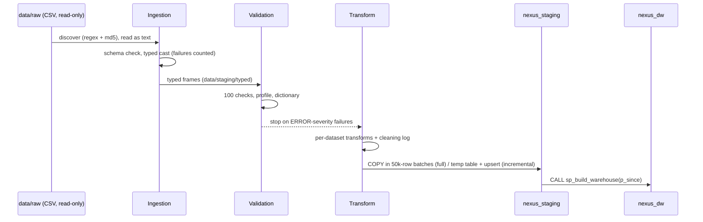

# ETL Documentation – NEXUS BI

## Flow



## Per-dataset transforms (`src/transformation/`)

| Dataset | Script | Main rules |
|---|---|---|
| customers | `customers.py` | zip → 5-char string, city lower-case/accent-free, state upper, dedupe on `customer_id` |
| sellers | `sellers.py` | same geography normalisation |
| geolocation | `geolocation.py` | drop 279,694 exact duplicates, drop 27 points outside Brazil, aggregate to 19,011 zip prefixes (median lat/lng, modal city/state) |
| products | `products.py` | rename misspelt `*_lenght`, fill 610 missing categories with `unknown`, translate (+2 manual), 0 g → NULL, volume |
| category_translation | `category_translation.py` | normalise keys, append manual translations, display names |
| orders | `orders.py` | status normalised, impossible timestamps (before purchase) → NULL (166), delivery metrics & flags, revenue flag |
| order_items | `order_items.py` | drop price ≤ 0 / freight < 0 (none found), line total |
| payments | `payments.py` | installments 0 → 1 (2), type normalised |
| reviews | `reviews.py` | grain (review_id, order_id), `is_latest_for_order` (551 older reviews flagged, not deleted), sentiment band |

All counts above are from the actual run and are recorded in `reports/data_quality/cleaning_log.csv`.

## Marts (`src/transformation/marts.py`)
`order_mart` (1 row/order with item, payment, review aggregates – no fan-out), `customer_mart` (1 row/person),
`daily_kpis` (gap-filled calendar), `category_weekly`, `items_enriched`, `headline_kpis.json`.

## Loading (`src/database/loader.py`)
* Raw: `COPY ... FROM STDIN (FORMAT csv, HEADER)` streamed in 1 MB blocks.
* Staging full: `TRUNCATE` + batched `COPY` (`NEXUS_LOAD_BATCH_SIZE`, default 50,000).
* Staging incremental: rows newer than `etl_watermark` → temp table → `INSERT … ON CONFLICT DO UPDATE`; then
  `sp_build_warehouse(p_since)` reloads only the affected fact window and SCD2-merges new customers.
* Tested: `tests/integration/test_warehouse.py::test_incremental_fact_reload_is_idempotent`,
  `::test_scd2_merge_adds_version_for_moved_customer`.

## Scale-out option (PySpark)
`src/transformation/spark_jobs.py` re-implements the 1M-row geolocation aggregation and daily revenue aggregation in
Spark with identical rules; `tests/integration/test_spark_parity.py` asserts equality with pandas.

## Synthetic data
`src/synthetic/generate.py` – seeded unit costs and weekly inventory (see `data/synthetic/README.md`). Loaded into
`nexus_dw.syn_*` with `CHECK (is_synthetic)`.

## Running
```powershell
python -m src.pipeline --stage extract     # or: all | validate | transform | load | analytics | predict | publish
python -m src.pipeline --stage load --incremental
```
