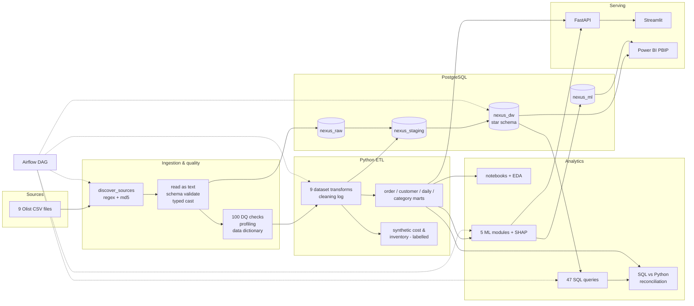
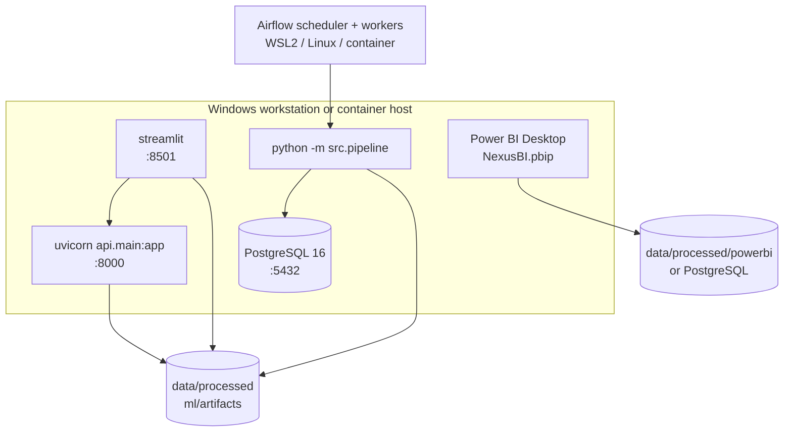

# Technical Architecture – NEXUS BI

## 1. Logical architecture

## 2. Pipeline stages (src/pipeline.py)

| Stage | Input | Output | Idempotency |
|---|---|---|---|
| extract | `data/raw/*.csv` | `data/staging/typed/*.parquet`, `source_inventory.csv` | overwrite |
| validate | typed parquet | `dq_checks.csv`, `column_profile.csv`, `data_dictionary.csv`; fails on ERROR checks | overwrite |
| transform | typed parquet | `data/staging/clean/*.parquet`, `data/processed/*.parquet`, synthetic, sample, DQ HTML | overwrite |
| load | clean parquet + raw CSV | `nexus_raw` (TRUNCATE+COPY), `nexus_staging` (TRUNCATE+COPY or upsert), `CALL sp_build_warehouse()` | full reload or watermark-incremental |
| analytics | warehouse | `reports/sql_results/*.csv`, `_reconciliation.csv` | overwrite |
| predict | processed marts | `ml/artifacts/*`, `data/processed/*forecast*`, evaluation report | overwrite |
| publish | ML outputs, warehouse | `nexus_ml.*` (TRUNCATE+COPY), `data/processed/powerbi/*.csv` | overwrite |

## 3. Key design decisions

| Decision | Rationale |
|---|---|
| Read CSVs as text, then cast with failure counts | No silent coercion (zip-code leading zeros, malformed numbers are counted, not dropped). |
| Four schemas in one database (`nexus_raw`, `nexus_staging`, `nexus_dw`, `nexus_ml`) instead of two databases | Cross-layer SQL (procedures, reconciliation) is possible; separation and permissions are still per schema. The brief's "nexus_raw / nexus_dw" layers map 1:1 to schemas. |
| Warehouse built in SQL procedures from staging; Python builds marts independently | Two independent implementations make reconciliation meaningful. |
| SCD2 on customer address | Olist issues a new `customer_id` per order; 259 additional address versions exist, and 244 customers with revenue orders bought from more than one address (SQL Q18). Rebuild on full loads, row-by-row merge on incremental loads. |
| Unknown members (key −1) | Facts never lose rows through failed lookups; tests assert none actually land there. |
| Revenue = item price + freight (not payment value) | Splittable by product/seller; payments include interest and canceled orders. |
| Reliable window detection | Data capture is truncated after 2018-08-22; models must not learn an artificial collapse. |
| Direct (lags ≥ 30) XGBoost forecaster | No recursive error accumulation and provably no look-ahead for a 30-day horizon. |
| API reads processed marts, not the DB | API works without PostgreSQL (Docker/Azure friendly); same marts are reconciled to the warehouse. |
| Power BI model generated from data extracts | Every column/relationship/visual reference is guaranteed to exist; static validator + DAX logic re-check. |

## 4. Physical / deployment view

Cloud target (prepared, **not deployed**): Azure Container Apps (api, app), Azure Database for PostgreSQL Flexible
Server, Azure Files for `data/` and `ml/artifacts`, Power BI Service with an on-premises/VNet gateway. See
`docs/deployment/DEPLOYMENT_GUIDE.md`.

## 5. Cross-cutting concerns
* **Logging:** `src/logging/logger.py` – console + `logs/nexus_bi.log`; every step writes a JSON record to
  `logs/pipeline_runs.jsonl` (shown on the System Monitoring page).
* **Configuration:** `src/config/settings.py`; all secrets via env vars / `.env` (git-ignored).
* **Error handling:** DQ errors stop the pipeline (`DataQualityError`); reconciliation failure fails the Airflow task;
  API maps missing artifacts to 503 and validation errors to 422.
* **Testing:** see `docs/TESTING_REPORT.md`.
