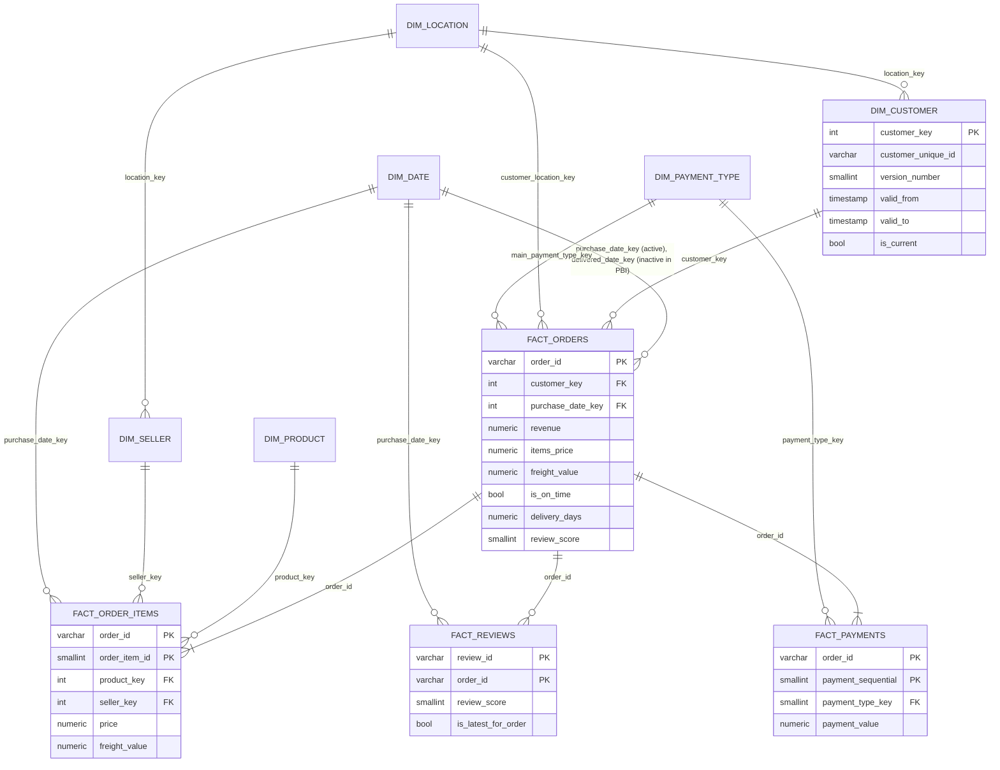

# Database Schema – NEXUS BI (PostgreSQL 16)

Schemas: `nexus_raw` (TEXT landing), `nexus_staging` (typed, PK/CHECK constraints), `nexus_dw` (star schema),
`nexus_ml` (model outputs). DDL: `sql/`. Initialise: `python -m src.database.init_db` (idempotent; `--reset` drops).

## Star schema

## Fact grains (avoiding fan-out)

| Fact | Grain | Measures | Rule |
|---|---|---|---|
| `fact_orders` | 1 row per `order_id` | revenue, items_price, freight, payment_value, delivery metrics, latest review | All order-level KPIs come from here. |
| `fact_order_items` | 1 row per (`order_id`, `order_item_id`) | price, freight, line_total | Category/seller revenue only from here. |
| `fact_payments` | 1 row per (`order_id`, `payment_sequential`) | payment_value, installments | Never join to items directly (fan-out); aggregate first. |
| `fact_reviews` | 1 row per (`review_id`, `order_id`) | review_score, response time | `review_id` alone is not unique in the source. |

Row counts after load (= source rows; verified by reconciliation): fact_orders 99,441 · fact_order_items 112,650 ·
fact_payments 103,886 · fact_reviews 99,224 · dim_customer 96,356 (incl. Unknown) · dim_product 32,952 ·
dim_seller 3,096 · dim_location 19,175 · dim_date 1,827 (2016-01-01 → 2020-12-31, derived from data range).

## Slowly changing dimensions
* **DIM_CUSTOMER – Type 2** on (zip, city, state) per `customer_unique_id`; `valid_from/valid_to/is_current/version_number`.
  `map_customer_id` bridges the order-scoped source `customer_id` to the version valid at order time.
  Full load: `sp_rebuild_dim_customer()`; incremental: `sp_merge_dim_customer()` (closes the current version and opens a new one when the address changes).
* **DIM_PRODUCT, DIM_SELLER, DIM_LOCATION – Type 1** upserts (`ON CONFLICT DO UPDATE`), keys stable across runs.

## Procedures
`sp_build_warehouse(p_since)` → `sp_load_dim_date` (range derived from data) → `sp_load_scd1_dimensions` →
(`sp_rebuild_dim_customer` + `sp_load_facts(NULL)`) or (`sp_merge_dim_customer` + `sp_load_facts(p_since)`) →
`sp_refresh_materialized_views`. Every step logs into `nexus_dw.etl_audit_log`; `etl_watermark` stores the last loaded purchase timestamp.

## Views
`vw_orders`, `vw_order_items`, `vw_seller_scorecard` (aggregates each fact at its own grain before joining),
`vw_customer_360`, `vw_syn_category_margin` (SIMULATED). Materialized: `mv_daily_kpis`, `mv_monthly_category_sales`, `mv_customer_rfm`.

## Indexes & optimisation
FK indexes on all fact keys, partial covering index for revenue orders, BRIN on `purchase_timestamp`, `ANALYZE` after load
(`sql/optimization/01_indexes.sql`). Query rewrite case study: SQL_QUERY_DOCUMENTATION.md (Q27: 266 s → 0.18 s).

## Security
`nexus_bi_reader` (read-only) and `nexus_regional_analyst` roles (NOLOGIN; grant login out-of-band), RLS policy on
`dim_customer` driven by `security_user_region` (`sql/warehouse/02_security_rls.sql`). No passwords in SQL files.
