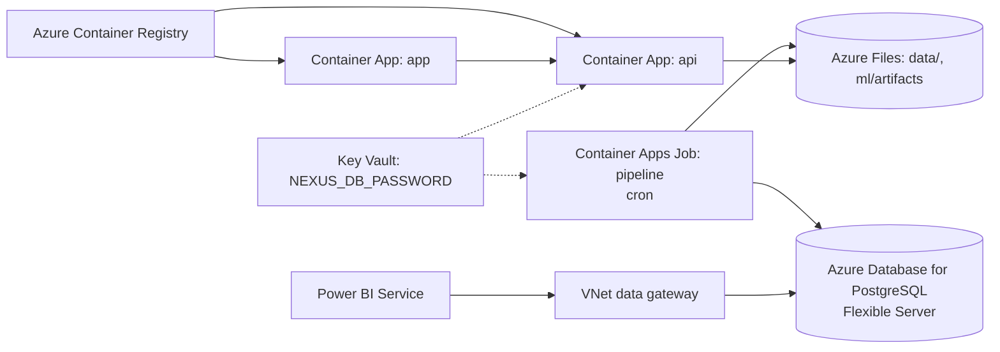

# Deployment Guide

| Target | Status |
|---|---|
| Local (Linux build environment): PostgreSQL 16 + pipeline + uvicorn + Streamlit + Airflow `dags test` | **Executed and tested** |
| Local Windows | Scripts provided (`scripts/nexus.ps1`); **not executed by the build agent** |
| Docker image build | **NOT RUN** – Docker Hub was blocked by the build environment's network policy. `docker compose config` validated the compose file. |
| Azure | **Prepared, not deployed** (no subscription/credentials were provided). |

## 1. Docker (local)
```bash
cp .env.example .env            # set NEXUS_DB_PASSWORD
docker compose up -d db
docker compose --profile pipeline run --rm pipeline     # needs data/raw/*.csv
docker compose up -d api app                            # :8000 and :8501
```
Image: `python:3.11-slim`, non-root user `nexus`, health check on `/health`.

## 2. Airflow
* Copy/mount `orchestration/dags/nexus_bi_pipeline.py` into the Airflow DAGs folder; set env var
  `NEXUS_PROJECT_ROOT` to the project path (and `NEXUS_DB_*`) for workers.
* Install `requirements-airflow.txt` in the Airflow environment (tested: Airflow 3.1.8).
* Variables: `nexus_bi_schedule` (default `@daily`, `None` = manual), `nexus_bi_incremental` (`true`/`false`).
* Verified here: DAG parses with no import errors; `airflow dags test nexus_bi_pipeline` → run state **success**
  (8 tasks success, failure handler skipped). A scheduler/worker deployment with a live schedule was **not** configured.

## 3. Azure (reference design – not executed)

Commands (Azure CLI, after `az login`):
```bash
az group create -n rg-nexus-bi -l brazilsouth
az acr create -g rg-nexus-bi -n <acrname> --sku Basic
az acr build -r <acrname> -t nexus-bi:1.0 .
az postgres flexible-server create -g rg-nexus-bi -n <pgname> --tier Burstable --sku-name Standard_B1ms --version 16
az containerapp env create -g rg-nexus-bi -n nexus-env -l brazilsouth
az containerapp create -g rg-nexus-bi -n nexus-api --environment nexus-env --image <acrname>.azurecr.io/nexus-bi:1.0 \
   --target-port 8000 --ingress external --secrets db-pass=<from-key-vault> \
   --env-vars NEXUS_DB_HOST=<pgname>.postgres.database.azure.com NEXUS_DB_USER=nexus NEXUS_DB_PASSWORD=secretref:db-pass
az containerapp create -g rg-nexus-bi -n nexus-app --environment nexus-env --image <acrname>.azurecr.io/nexus-bi:1.0 \
   --target-port 8501 --ingress external --command streamlit --args "run app/streamlit_app.py --server.port 8501 --server.address 0.0.0.0" \
   --env-vars NEXUS_API_URL=https://<nexus-api-fqdn>
```
Mount an Azure Files share at `/app/data` and `/app/ml/artifacts` for both apps and the pipeline job.
Power BI Service: publish the PBIX, switch the source to PostgreSQL (`powerbi/power_query/postgresql/*.pq`), configure the
gateway, map RLS role members, enable incremental refresh.

## 4. Security checklist
* `.env` never committed (`.gitignore`); secrets via Key Vault / Container Apps secrets in cloud.
* Database roles least-privilege (`nexus_bi_reader` for BI); RLS for regional analysts.
* API is read-only + scoring; put it behind authentication (Azure AD / API Management) before exposing publicly.
