# NEXUS BI – Exploratory Data Analysis Report

_Generated 2026-11-12 15:16 UTC by `scripts/generate_reports.py` from the processed Olist data. Every number and sentence under each chart is computed from the data._

## Headline facts

| Metric | Value |
|---|---|
| Revenue (item price + freight, non-canceled/unavailable orders) | R$ 15,735,527.03 |
| Orders (revenue-recognised) | 98,207 of 99,441 |
| Unique customers | 94,990 |
| Average order value | R$ 160.23 |
| On-time delivery rate | 93.23% |
| Average delivery time | 12.6 days |
| Average review score | 4.09 / 5 |
| Cancellation rate | 0.63% |

> Data-capture caveat: order volume collapses after 2018-08-22 (extraction truncation). Time-series models and trend statements use 2017-01 → 2018-08-21.

## Order value distribution

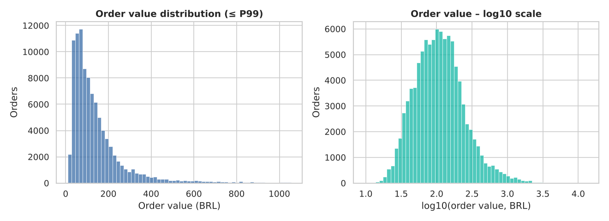

**Interpretation.** Order values are strongly right-skewed (skew 9.3): median R$ 105.28 vs mean R$ 160.24; 10% of orders exceed R$ 307. Use medians and log-scales for reporting; averages are pulled up by a long tail of high-ticket orders.

## Delivery time vs estimate

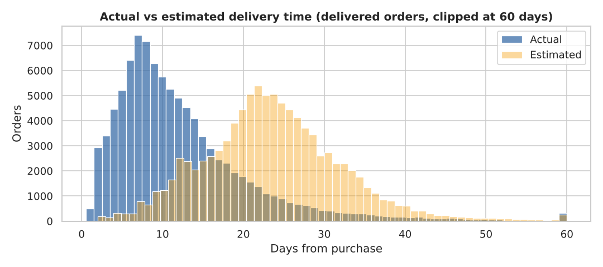

**Interpretation.** Median delivery takes 10.2 days against a median promise of 23.2 days, so 93.2% of orders arrive on or before the estimate. Estimates are padded by roughly 13 days – reliable, but long promised lead times may cost conversion.

## Price vs freight

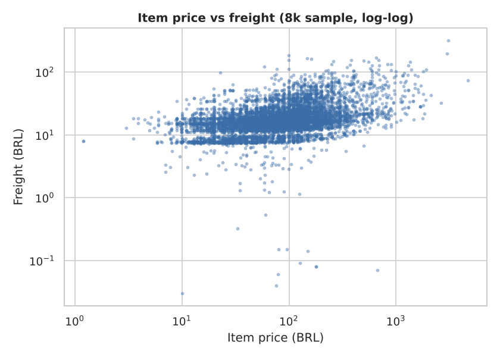

**Interpretation.** Freight rises with price (Spearman ρ = 0.43, p < 0.001) but far less than proportionally: the median item pays freight worth 23% of its price, and on 3.7% of items freight exceeds the price itself – a conversion risk for cheap items.

## Delivery delay vs satisfaction

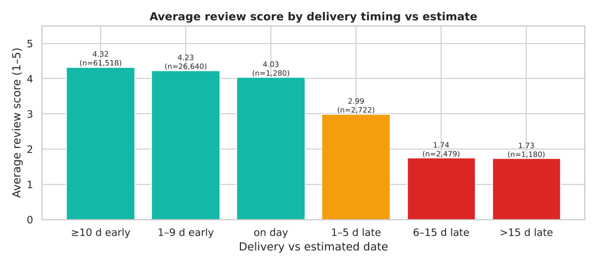

**Interpretation.** On-time orders average 4.29 stars versus 2.27 for late orders – a gap of 2.02 points. Orders more than 15 days late average 1.73. Lateness is the most visible driver of dissatisfaction in the data (association; see hypothesis test H1).

## Multivariate correlation

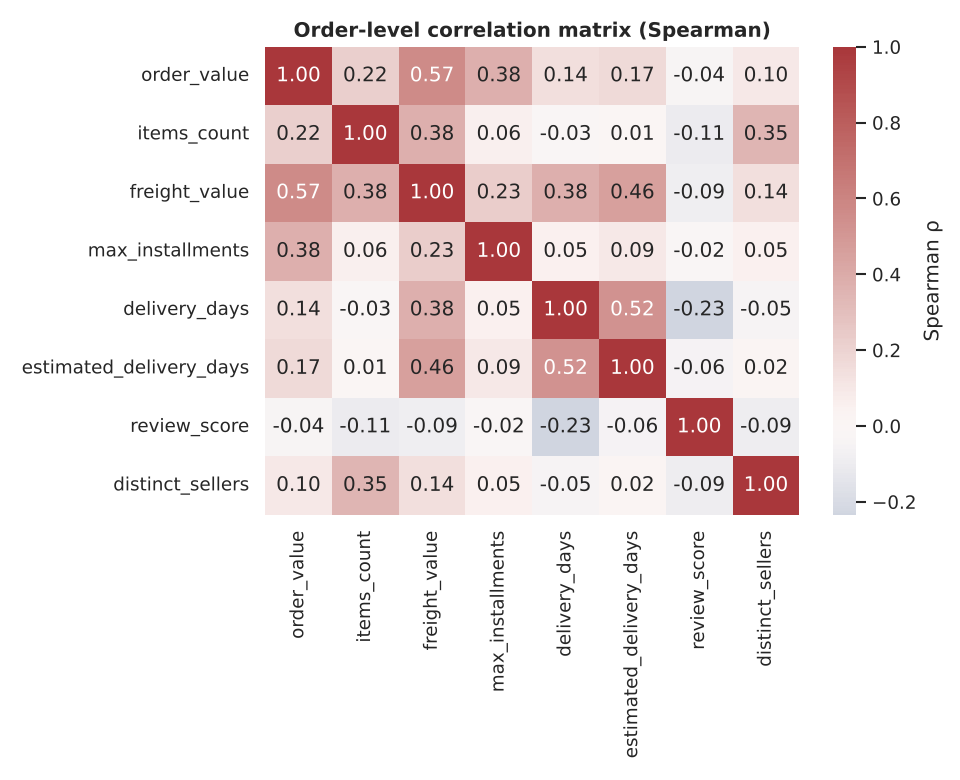

**Interpretation.** Strongest associations: order_value ~ freight_value (ρ=0.57); delivery_days ~ estimated_delivery_days (ρ=0.52); freight_value ~ estimated_delivery_days (ρ=0.46); freight_value ~ delivery_days (ρ=0.38). Review score correlates negatively with delivery days (ρ=-0.23) and only weakly with order value – customers judge logistics more than price.

## Order-value outliers

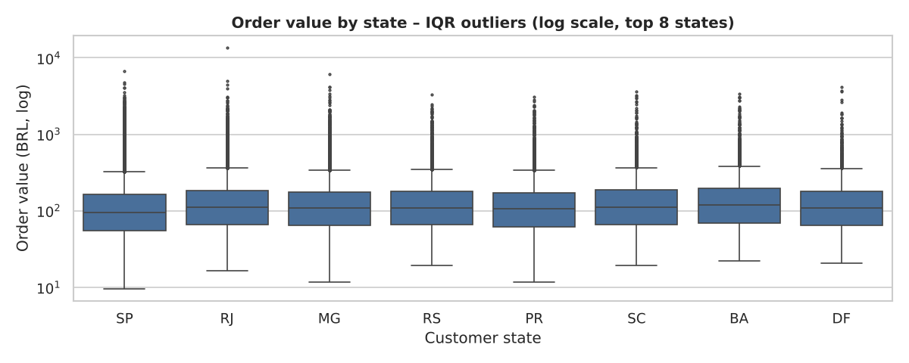

**Interpretation.** 7,734 orders (7.9%) exceed the IQR fence of R$ 349, yet they carry 33.8% of revenue. They are legitimate high-ticket purchases, not errors – keep them, but use robust statistics (median, trimmed means) for typical-customer KPIs.

## Revenue over time

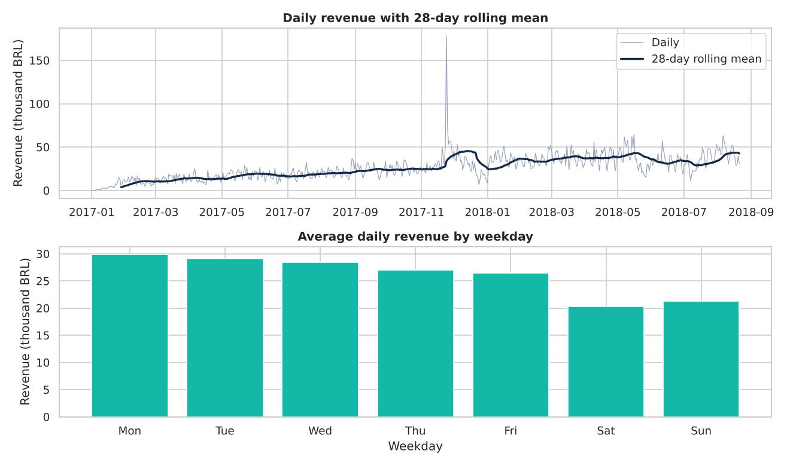

**Interpretation.** Revenue grew 140% Jan–Aug 2018 vs 2017 but plateaued from early 2018. The single biggest day was 2017-11-24 (Black Friday, R$ 178,378). Weekdays out-earn weekends; the weakest weekday averages 68% of the strongest.

## Product performance

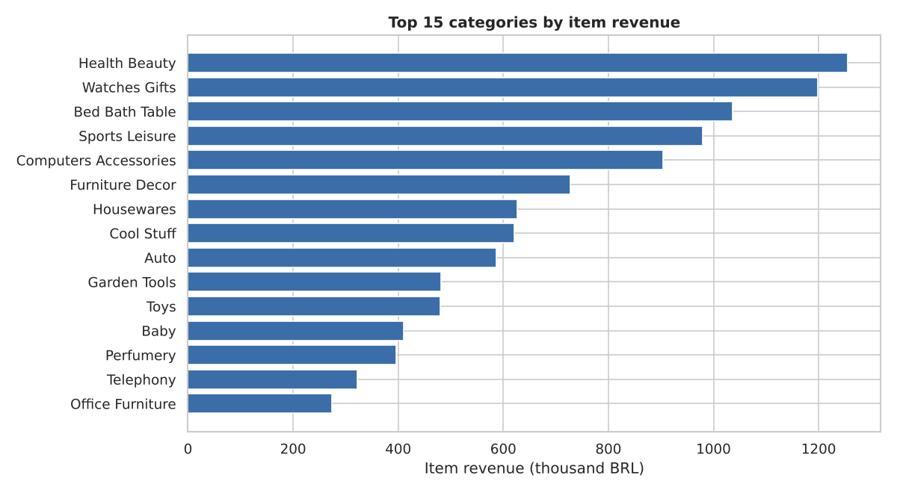

**Interpretation.** The top 10 of 74 categories generate 62% of item revenue; 'health beauty' leads. The catalogue is a long tail: 73% of products sold fewer than 3 units, so demand planning must happen at category, not SKU, level.

## Geographic concentration

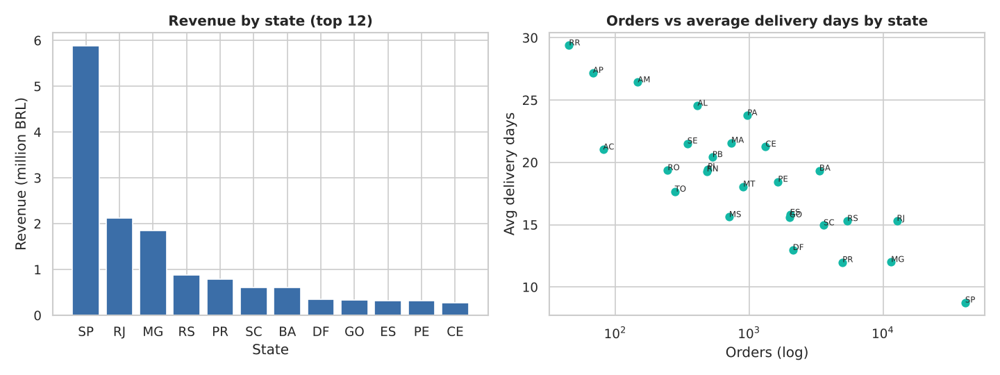

**Interpretation.** São Paulo alone generates 37% of revenue and SP+RJ+MG 63%. SP orders arrive in 8.8 days on average versus 29.4 in RR. Because 71% of items ship from São Paulo sellers, delivery time grows with distance from SP, limiting growth in the North/Northeast.

## Late deliveries

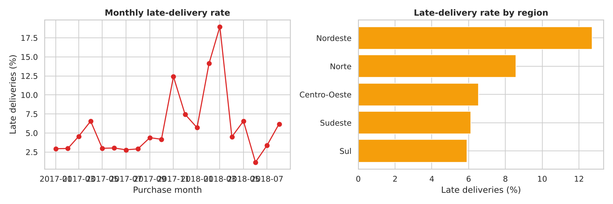

**Interpretation.** Late-delivery rates spike in a few months – 2018-03 (19.0%), 2018-02 (14.1%), 2017-11 (12.4%) – versus a monthly median of 4.4%, i.e. logistics capacity breaks under demand peaks (Nov-2017 = Black Friday). By region, Nordeste is late 12.7% of the time vs 5.9% in Sul.

## Repeat purchasing

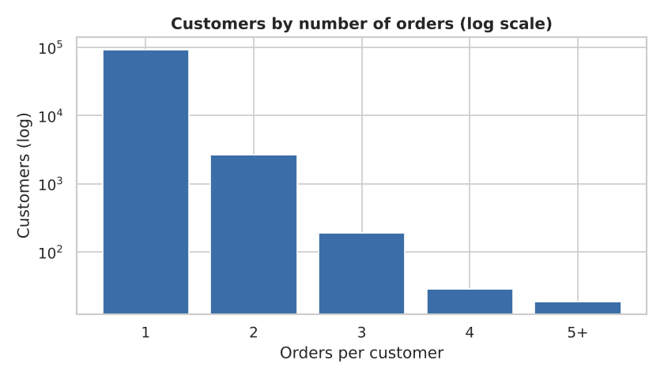

**Interpretation.** Only 3.04% of 94,983 customers ordered more than once; they contribute 5.7% of revenue and are worth 1.9× a one-time buyer. Retention is the single largest structural weakness of the business.

## Cohort retention

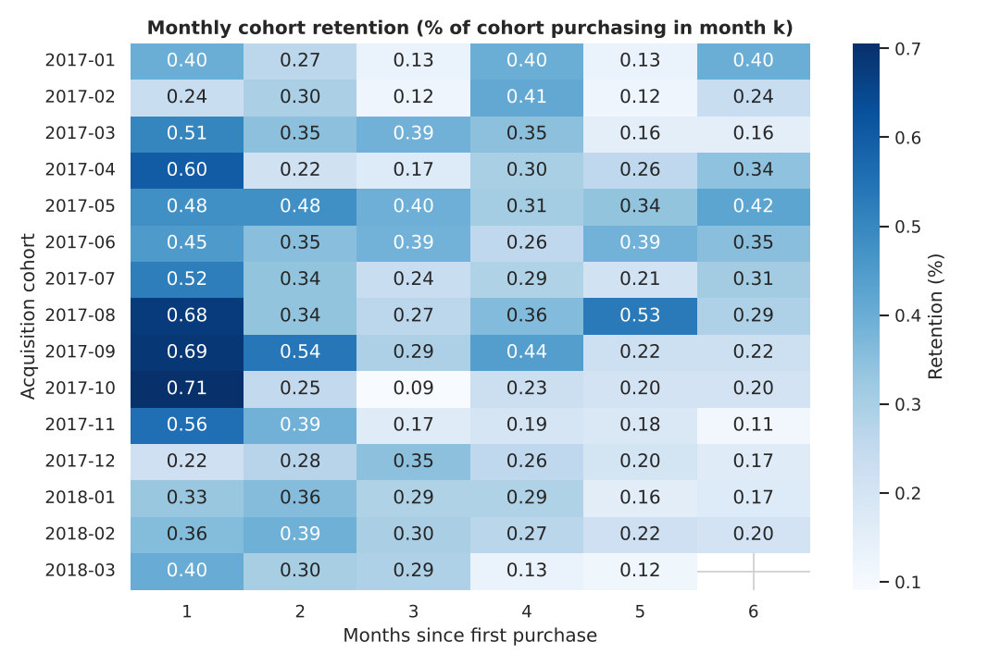

**Interpretation.** Average month-1 retention is 0.48% and stays below 0.5% from month 2 onward – cohorts do not build a recurring base. Every month's revenue must be re-acquired.

## Customer lifetime value

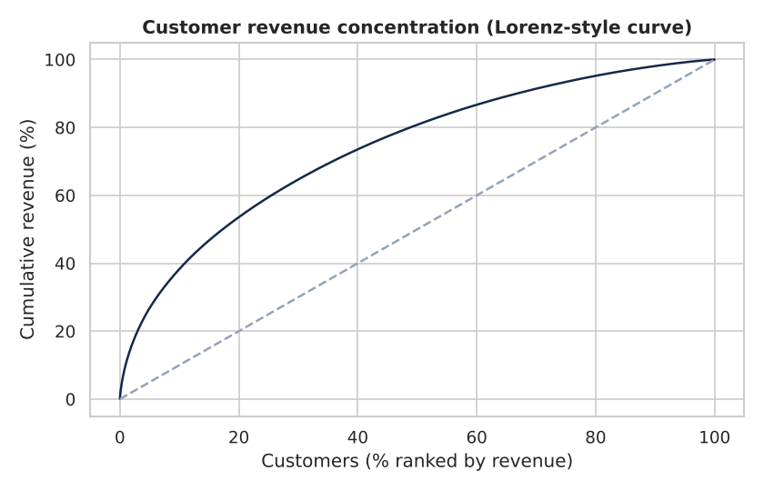

**Interpretation.** The top 20% of customers generate 54% of revenue. Historical CLV ≈ AOV R$ 160.24 × 1.034 orders = R$ 165.67; because frequency is ~1, CLV is essentially the first basket – raising frequency is the main CLV lever.

## Statistical hypothesis tests

| ID | Hypothesis | Test | Statistic | p-value | Effect size | Decision | Detail |
|---|---|---|---|---|---|---|---|
| H1 | Late orders receive lower review scores than on-time orders | Mann-Whitney U (one-sided) | 467,430,237.000 | < 1e-300 | rank-biserial r = 0.638 | Reject H0 | mean on-time 4.29 vs late 2.27 |
| H2 | Review score distribution differs between regions | Kruskal-Wallis H | 243.481 | 1.65e-51 | epsilon² = 0.0025 | Reject H0 | Centro-Oeste 4.13, Nordeste 3.97, Norte 4.03, Sudeste 4.18, Sul 4.19 |
| H3 | Late delivery is independent of customer region | Chi-square independence | 559.301 | 9.94e-120 | Cramér's V = 0.076 | Reject H0 | dof=4 |
| H4 | Delivery time is monotonically associated with review score | Spearman correlation | -0.235 | < 1e-300 | rho = -0.235 | Reject H0 |  |
| H5 | Weekend and weekday orders have the same mean (log) order value | Welch t-test on log(order value) | -1.102 | 0.27 | geo-mean ratio = 0.993 | Fail to reject H0 | median weekend 105.76 vs weekday 105.28 |
| H6 | Credit-card and boleto orders have the same order-value distribution | Mann-Whitney U (two-sided) | 799,912,563.000 | 2.94e-113 | – | Reject H0 | median card 109.50 vs boleto 93.82 |

**Interpretation.** 5 of 6 null hypotheses rejected at α = 0.05 (H1, H2, H3, H4, H6). With ~100k observations even tiny differences are 'significant', so effect sizes matter: the delivery-delay effect on reviews (H1) is material, while the regional review differences (H2) are statistically real but small.

_All tests are observational: they establish association, not causation._